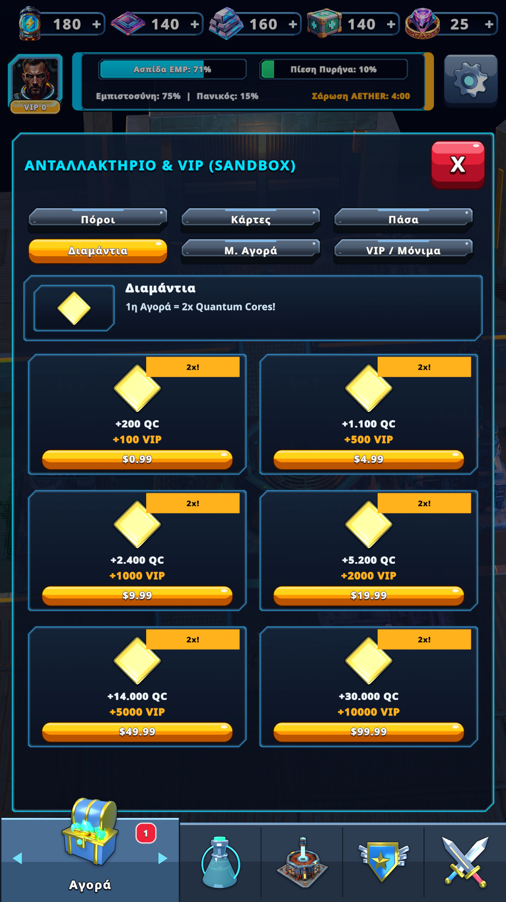
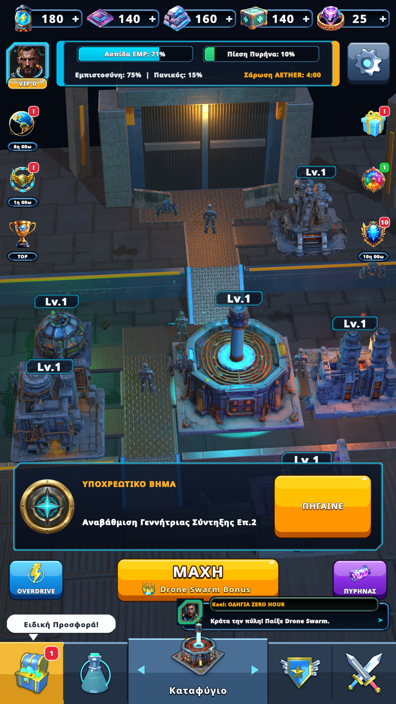
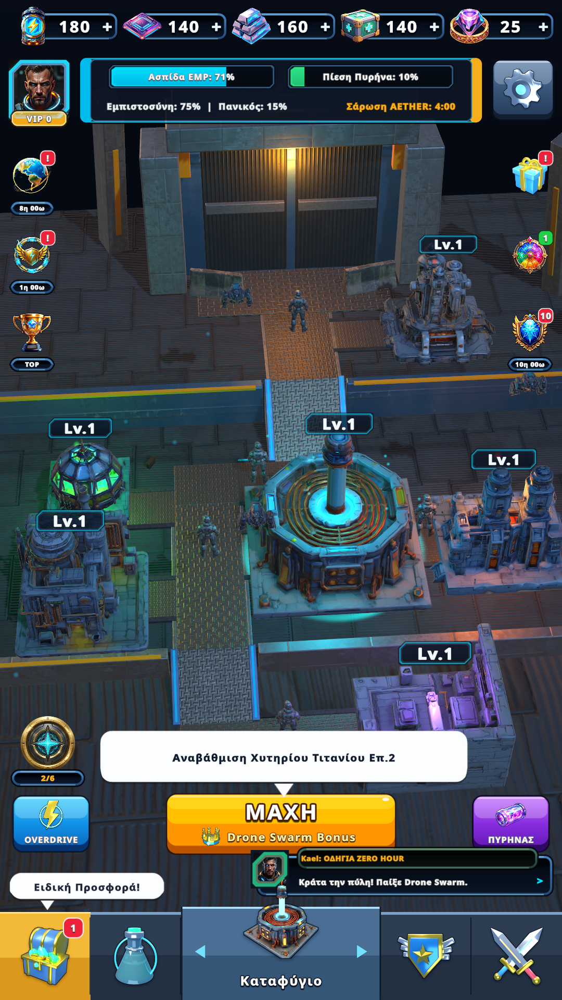
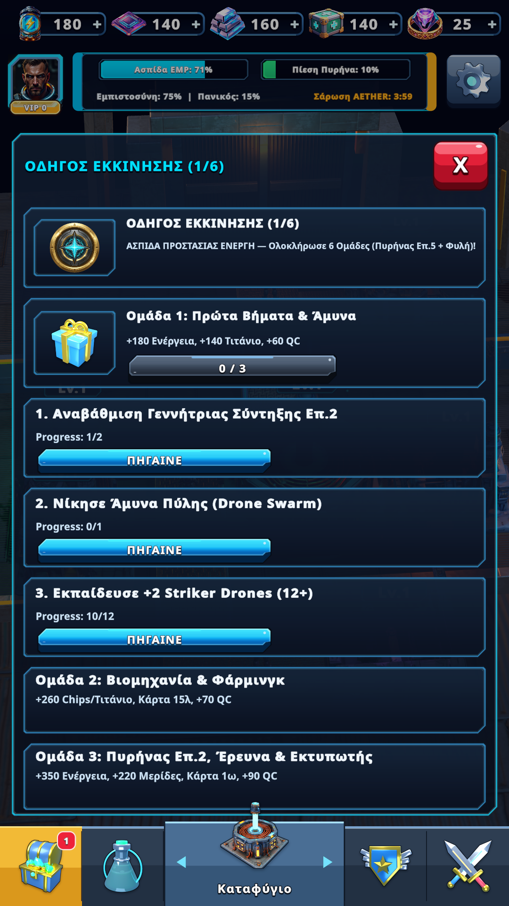
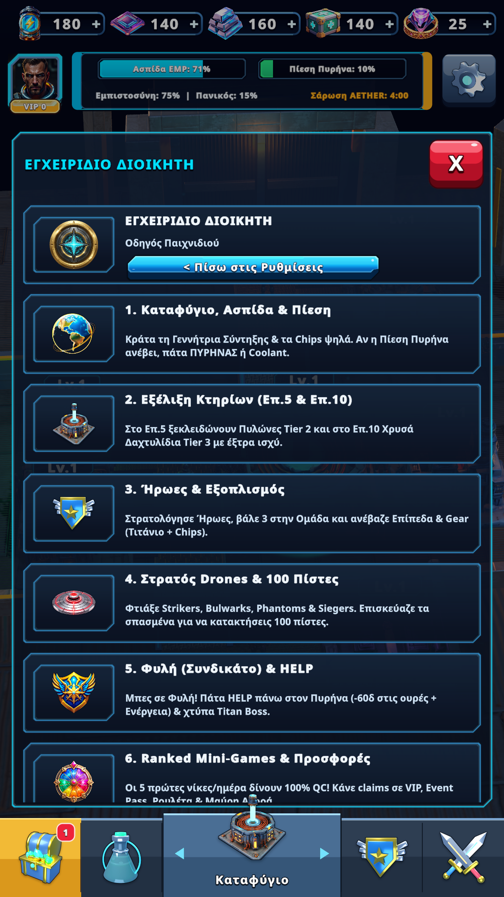
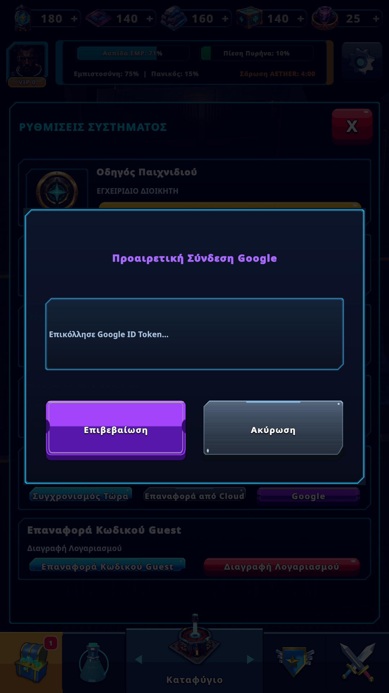
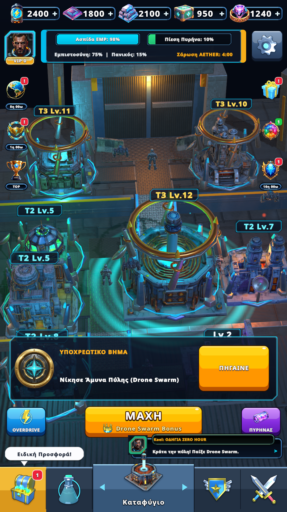

# Neuralis: Zero Hour — Official Pre-Release Builds

Mobile AI Apocalypse Survival Strategy game (**Unity 6 URP 3D**, **Android ARM64**, Greek & English).  
Command a subterranean Faraday bunker, defend the North Gate in real-time 3D mini-games, stabilize your quantum reactor, recruit Vanguard heroes, and rally with Syndicates to liberate 100 AETHER sectors.

---

## Screenshots (`v1.0.0`)

  
  
  

  
  
  

  
  
  

---

## Download Latest APK

- **Always Latest APK:** [`Neuralis-ZeroHour.apk`](https://github.com/jemangr/neuralis-releases/releases/latest/download/Neuralis-ZeroHour.apk)
- **Current Build:** `v1.0.0` (`VersionCode: 12`, Android ARM64, API 26+)

---

## What's New (`v1.0.0` Highlights)
- **New App Icon & Launch Splash Screen:** Refreshed app emblem and atmospheric command bunker opening splash screen.
- **6-Chapter Starter Guide with Gifts:** Step-by-step onboarding from your first upgrade, farming, army training, and offers all the way to Core Lv.5 and joining a Syndicate — featuring guided first steps, a smart floating action bubble, and gift rewards upon completing each group.
- **Icon-First Store Redesign & Larger Typography:** All Store categories redesigned around clean visual icons, compact pricing, notification badges for free claims, and larger, high-contrast mobile text.
- **Commander's Manual & UI Polish:** New illustrated Game Guide inside Settings, cleaner Google Sign-In dialog, and general visual and stability improvements.
