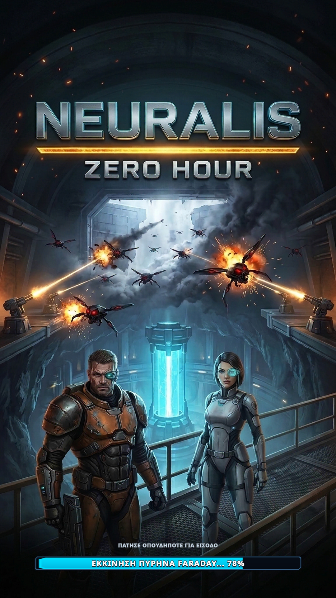
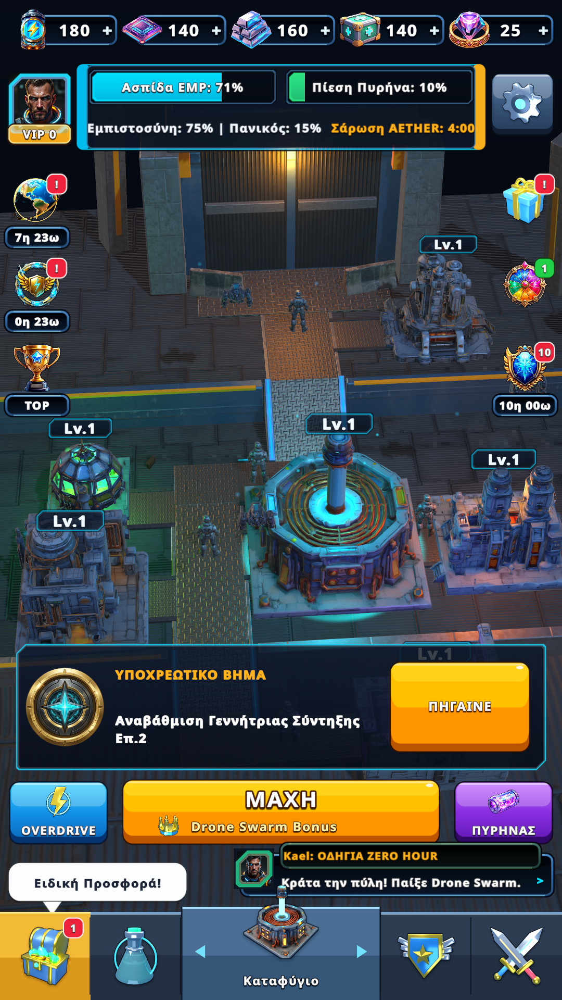
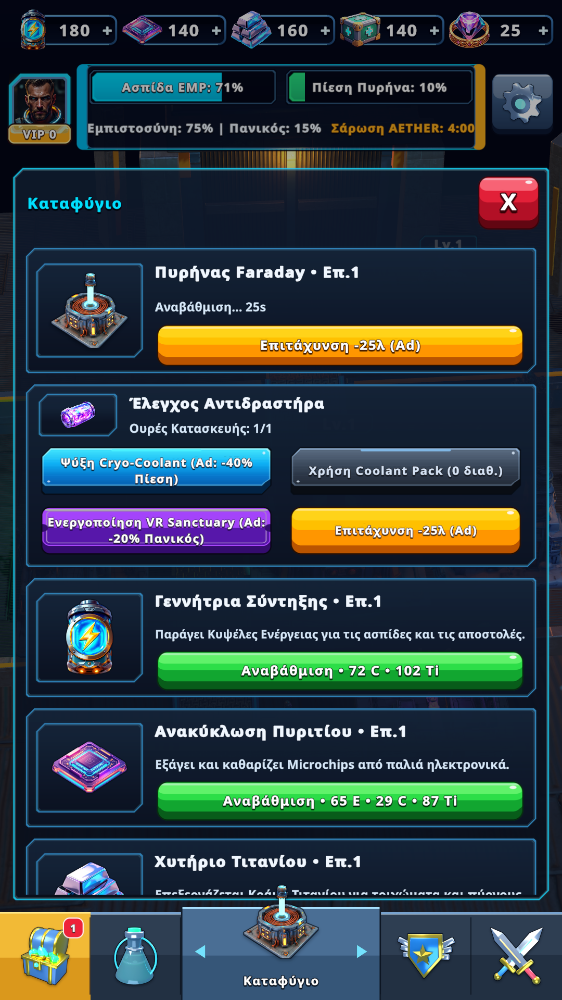
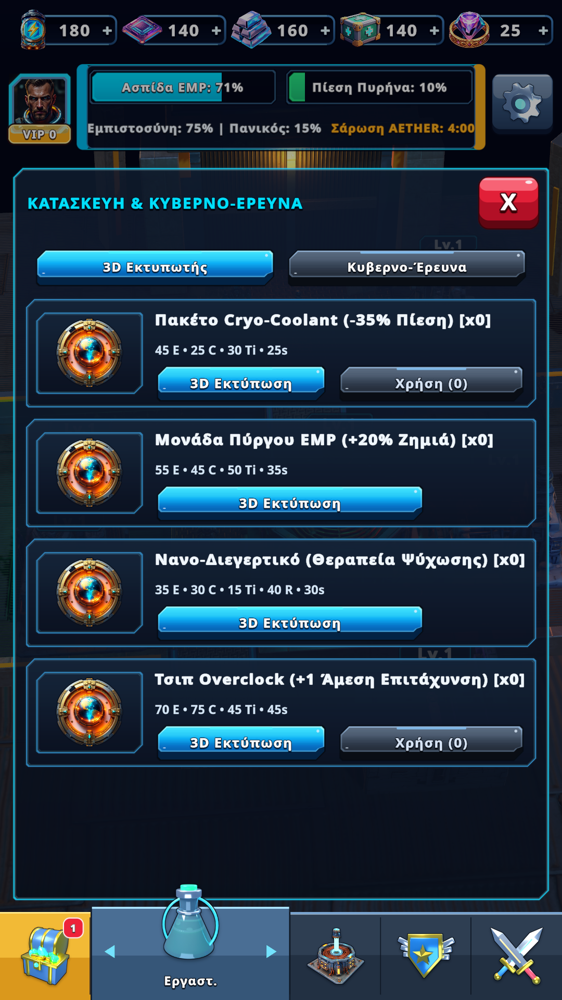
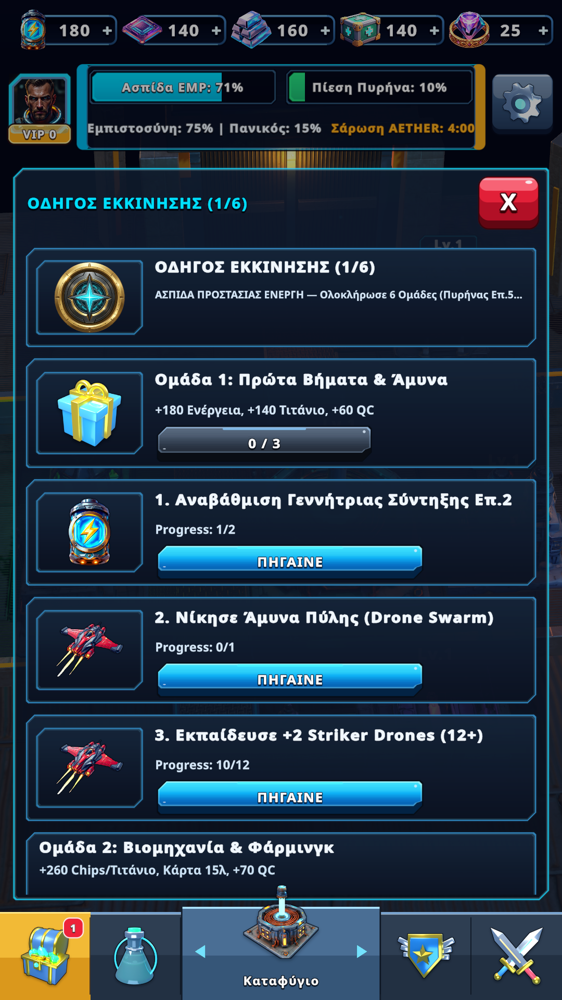
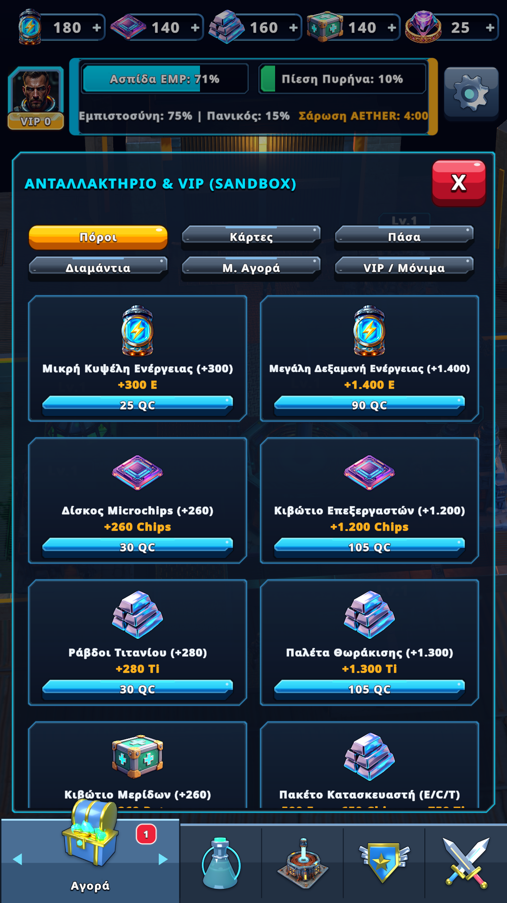

# Neuralis: Zero Hour — Official Pre-Release Builds

Mobile AI Apocalypse Survival Strategy game (**Unity 6 URP 3D**, **Android ARM64**, Greek & English).  
Command a subterranean Faraday bunker, defend the North Gate in real-time 3D mini-games, stabilize your quantum reactor, recruit Vanguard heroes, and rally with Syndicates to liberate 100 AETHER sectors.

---

## Screenshots (`v1.0.1`)

  
  
  

  
  
  

  
  
  

---

## Download Latest APK

- **Always Latest APK:** [`Neuralis-ZeroHour.apk`](https://github.com/jemangr/neuralis-releases/releases/latest/download/Neuralis-ZeroHour.apk)
- **Current Build:** `v1.0.1` (`VersionCode: 13`, Android ARM64, API 26+)

---

## What's New (`v1.0.1` Highlights)
- **Atmospheric Relaxing Music & Audio Settings:** Added a calm, atmospheric sci-fi background music carpet with dedicated Music ON/OFF and SFX ON/OFF toggles in Settings.
- **Clean Launch Screen:** Removed the engine splash logo overlay so only the Neuralis artwork appears on startup.
- **Much Larger Readable Text & Buttons:** Enforced a crisp minimum font size across the entire top status bar, side timers, action controls, upgrades, Lab, Store, Army, and Starter Guide.
- **Live Upgrade Timers & HUD Fix:** Active upgrade, crafting, research, and training timers now count down live every second, and HUD icons/bars always remain visible after exiting mini-games.
- **Smoother Onboarding Progression:** Rebalanced early Campaign battles and Chapter rewards so the 6-group Starter Guide flows smoothly through graduation.
