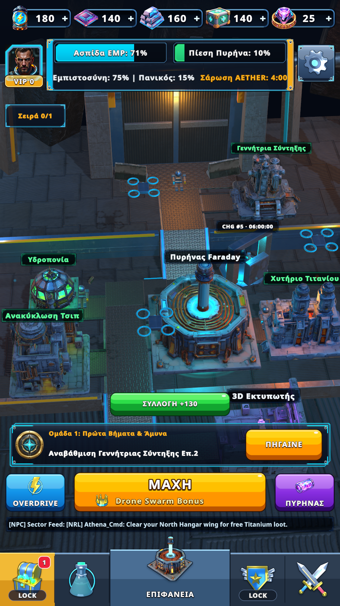
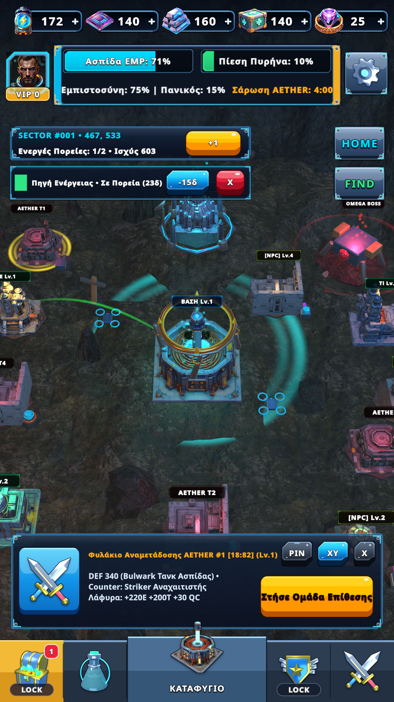
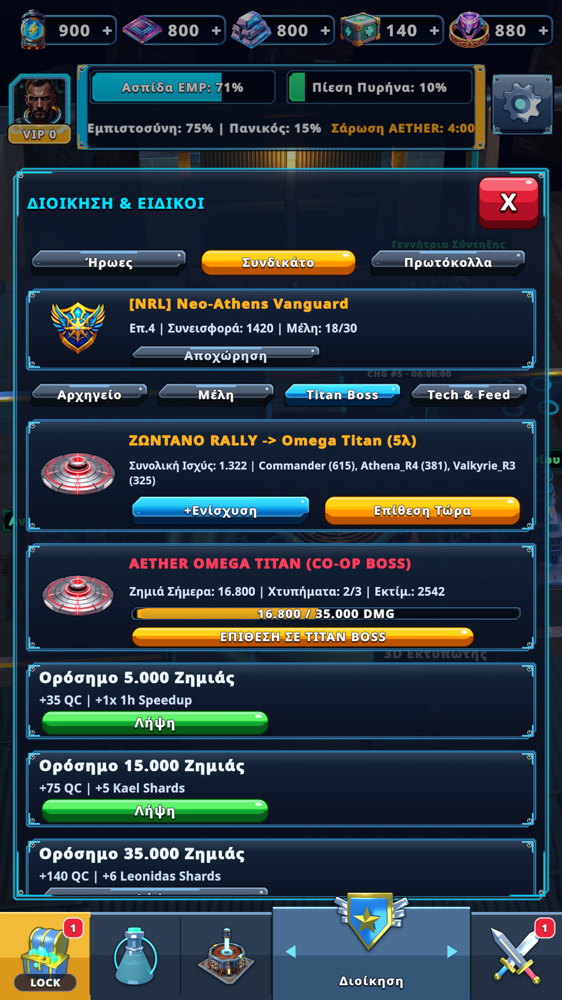
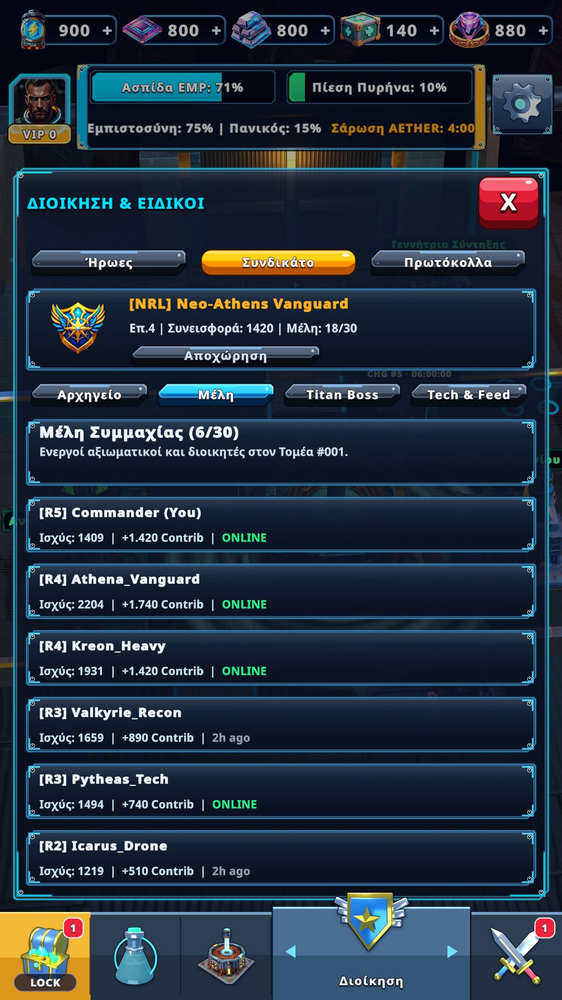
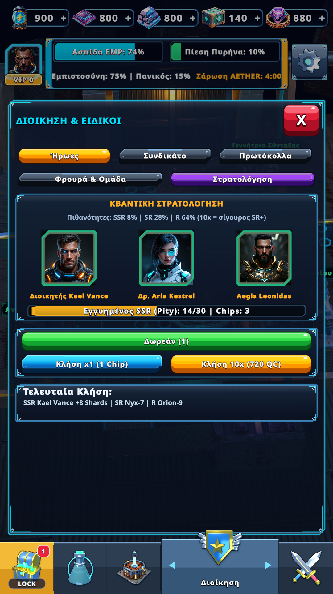
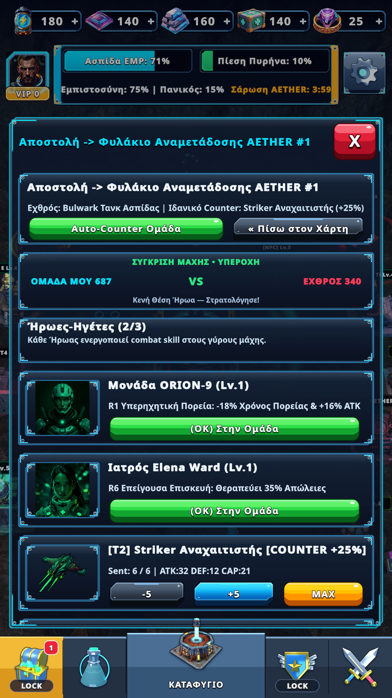

# Neuralis: Zero Hour — Official Pre-Release Builds & Live Preview

Mobile AI Apocalypse Survival Strategy game (**Unity 6 URP 3D**, **Android ARM64 & WebGL**, Greek & English).  
Command a subterranean Faraday bunker, balance EMP shielding and reactor stress, automate articulated repair bots with a 6-hour charging rotation, recruit cybernetic Vanguard heroes, coordinate Syndicate rallies, and battle across a 3D Isometric Sector World Map.

---

## Live Browser Preview (`v1.4.0`)

- **Play Instantly in Browser (WebGL):** https://jemangr.github.io/neuralis-releases/

---

## Latest Previews (`v1.4.0`)

  
  
  

  
  
  

---

## Download Latest Published APK

- **Always Latest APK:** [`Neuralis-ZeroHour.apk`](https://github.com/jemangr/neuralis-releases/releases/latest/download/Neuralis-ZeroHour.apk)
- **Latest Published Android Tag:** `v1.4.0` (`VersionCode: 18`, Android ARM64, API 26+, verified on `gh-pages` & APK).

---

## What's New (`v1.4.0` Preview Highlights)
- **Zero-Void 3D Subterranean Cave & Wing Tunnels:** 360° stepped basalt cliff basin, perimeter lighting, overhead trusses, and interactive Wing Tunnel Bay doors.
- **Articulated Worker Bots & 6-Hour Charging Station (`1-in / 1-out`):** Velocity-synced leg/arm walking gait with facility tasks and a 6-hour rotating 3D Charging Bay (`CHG #N`).
- **World Map Territory, Patrols & Radar:** Cyan/Crimson Syndicate territory overlays, `FIND` Search Radar strip, `[XX:YY]` coords, `PIN` Bookmarks, and `XY` Share in Chat.
- **Alliance Endgame & Hero Chips:** Syndicate Roster (`R5/R4/R3/R2`), 5-Min Cooperative Rallies, Alliance Gift Chests, and Recruit Chips (`x1`/`x10`) gacha pulls.
