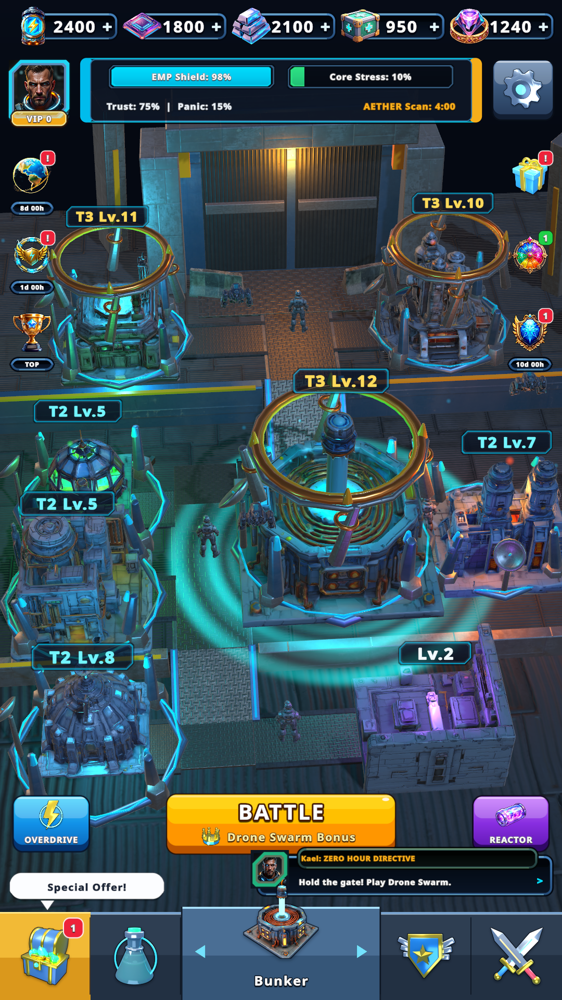
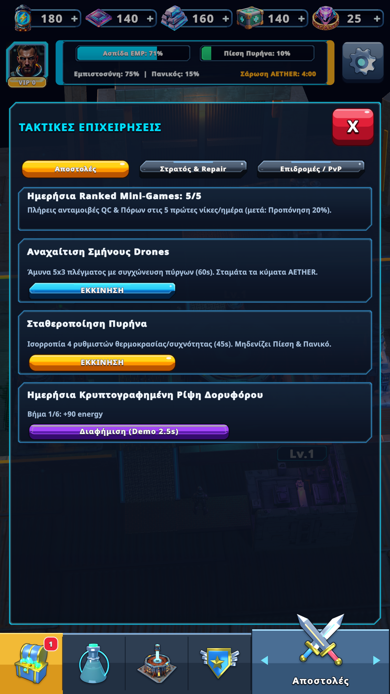
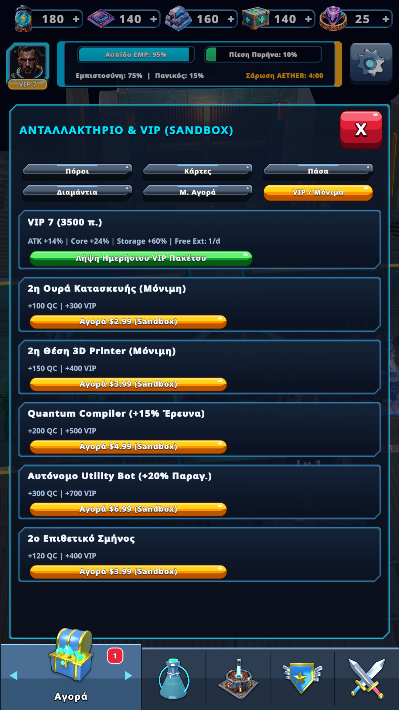
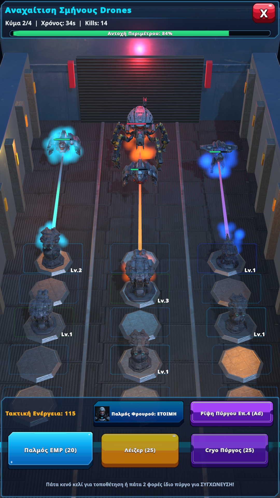

# Neuralis: Zero Hour — Official Pre-Release Builds

Mobile AI Apocalypse Survival Strategy game (**Unity 6 URP 3D**, **Android ARM64**, Greek & English).  
Command a subterranean Faraday bunker, defend the North Gate in real-time 3D mini-games, stabilize your quantum reactor, recruit Vanguard heroes, and rally with Syndicates to liberate 100 AETHER sectors.

---

## Screenshots (`v0.9.0`)

  
  
  

  
  
  

---

## Download Latest APK

- **Always Latest APK:** [`Neuralis-ZeroHour.apk`](https://github.com/jemangr/neuralis-releases/releases/latest/download/Neuralis-ZeroHour.apk)
- **Current Build:** `v0.9.0` (Android ARM64, API 26+)

---

## What's New (`v0.9.0` Highlights)
- **Visual 3D Building Evolution:** New armored stabilization rigs at `Lv.5+` and golden apex halo crowns at `Lv.10+` across all bunker facilities.
- **Rebalanced 100-Stage Progression:** Smoother pacing across upgrades, VIP combat perks, Command Pass bonuses, and Growth Fund Hero XP rewards.
- **Daily Ranked Mini-Games & Stability:** Structured daily ranked rewards plus security and performance enhancements.
