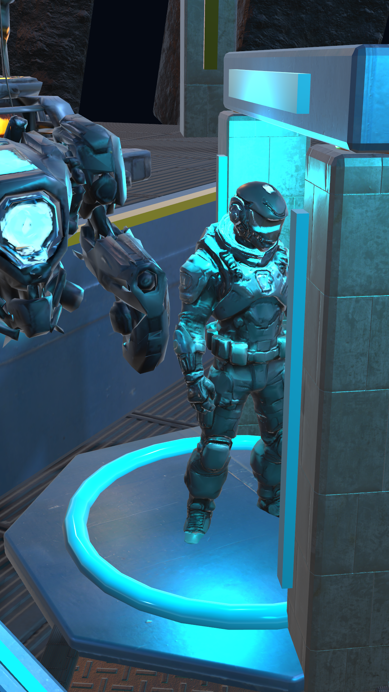
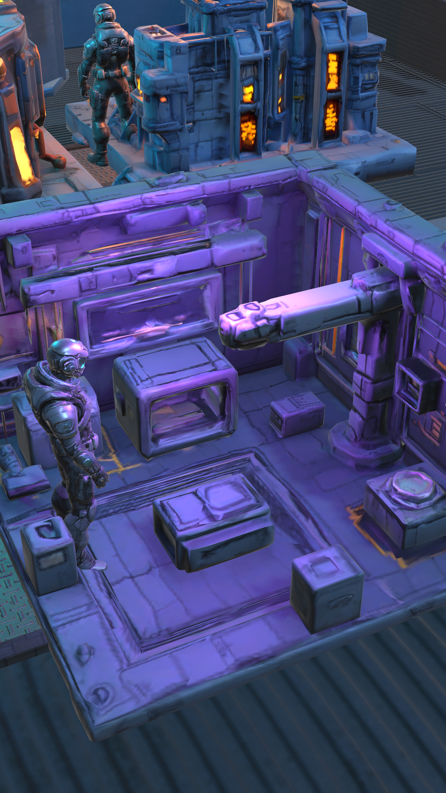
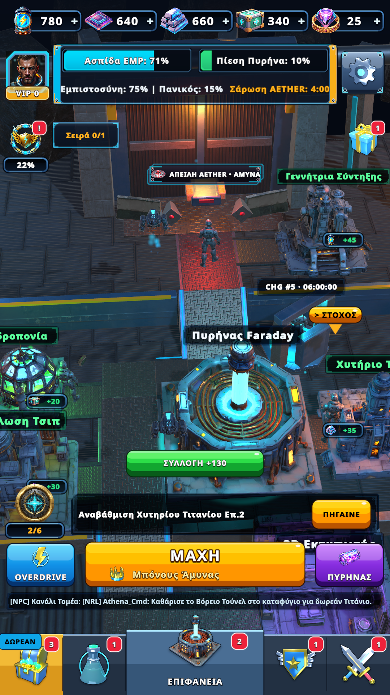
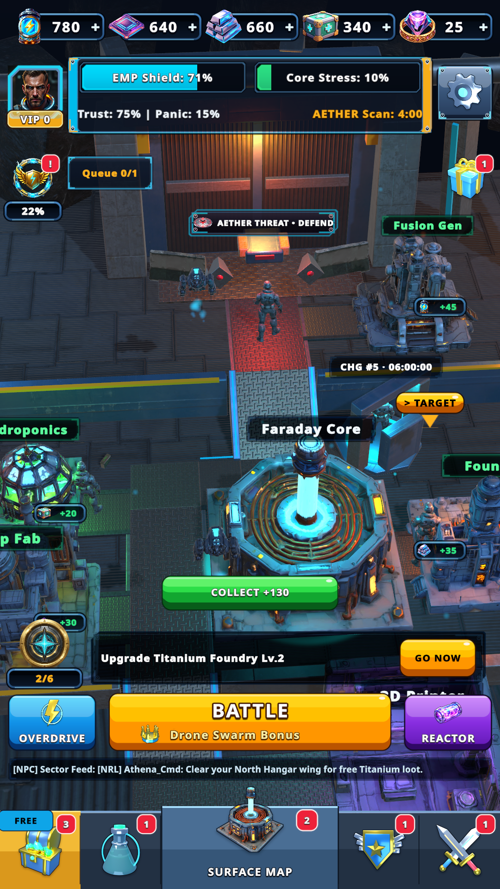
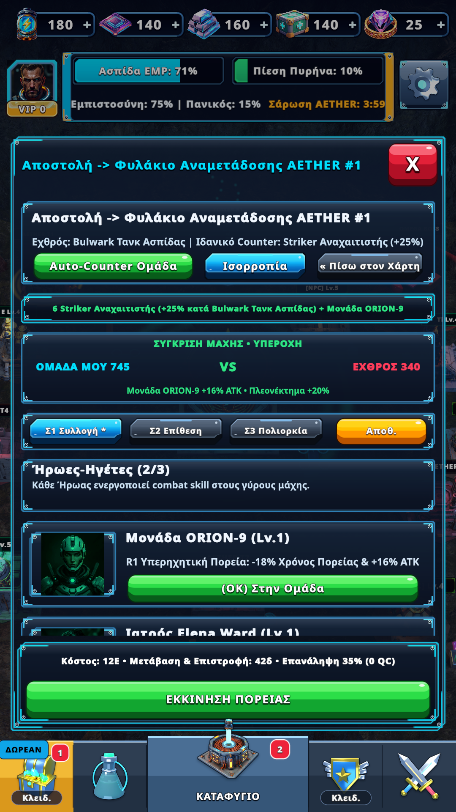

# Neuralis: Zero Hour — Official Pre-Release Builds & Live Preview

Mobile AI Apocalypse Survival Strategy game (**Unity 6 URP 3D**, **Android ARM64 & WebGL**, Greek & English).  
Command a subterranean Faraday bunker, balance EMP shielding and reactor stress, automate articulated repair bots with a 6-hour charging rotation, recruit cybernetic Vanguard heroes, coordinate Syndicate rallies, and battle across a 3D Isometric Sector World Map.

---

## Live Browser Preview (`v1.8.0`)

- **Play Instantly in Browser (WebGL):** https://jemangr.github.io/neuralis-releases/
- Built with Unity 6 **Gzip compression**, **decompression fallback**, **content-hashed `.unityweb` assets**, and `?v=1.8.0` cache busting.

---

## Latest Previews (`v1.8.0`)

  
  
  

  
  
  

---

## Download Latest Published APK

- **Always Latest APK:** [`Neuralis-ZeroHour.apk`](https://github.com/jemangr/neuralis-releases/releases/latest/download/Neuralis-ZeroHour.apk)
- **Latest Published Android Tag:** `v1.7.0` (`VersionCode: 21`, Android ARM64, API 26+, verified on `gh-pages` & APK).

---

## What's New (`v1.7.0`)
- **Actionable Objectives & Edge Beacon:** Smooth camera pan on target buildings, inline radial quick actions, directional `< / > / ^ / v` edge beacon when off-screen, and locked dock slots routing directly to the Faraday Core.
- **Decision-First Upgrades & Resource Shortfall Jump:** Upgrades lead with key unlocks or net per-minute output, show exact resource shortfalls (`Missing: +X Titanium`), and provide 1-tap `Collect` / `Go to Producer` / `Go to Core` shortcuts.
- **North Blast Gate AETHER Threat, Spatial Crates & Honest Debrief:** 3D AETHER patrol outside the North Gate triggers a brisk 40s Drone Swarm defense with explicit `Retry Defense (Full Crate)` vs `Continue Without Bonus`, strict win/loss outcome debriefing, interactive spatial bunker Supply Crates (`COLLECT!`), and floating producer harvest bubbles.
- **Auto-Counter Explanation & Clean Battle Report:** Dispatch explains exact counter units picked; Battle Report highlights Loot Secured, Hero Contributions, Drones Awaiting Repair + `Repair Now`, and collapsed `Round Details (6) [+]`.
- **3-Field Structured Store Passes:** Pass cards consistently present **Duration**, **Instant**, and **Daily + Claim Rule** while preserving instant access to the Daily Free Supply Crate.

### Previous: `v1.6.0` Highlights
- Unified outpost first-clear vs repeat `35% / 0 QC` rewards, single-formula combat matchup parity, pinned sticky Dispatch footer, net Energy Overdrive ETA, `0/3 -> 3/3` Syndicate build help, and WebGL Gzip compression.