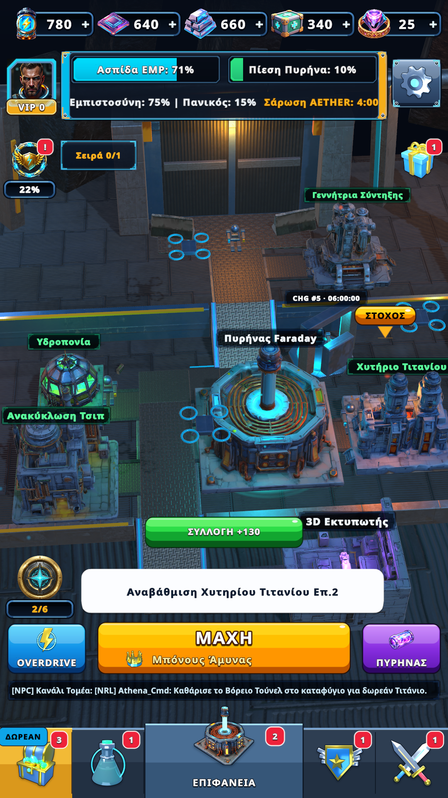
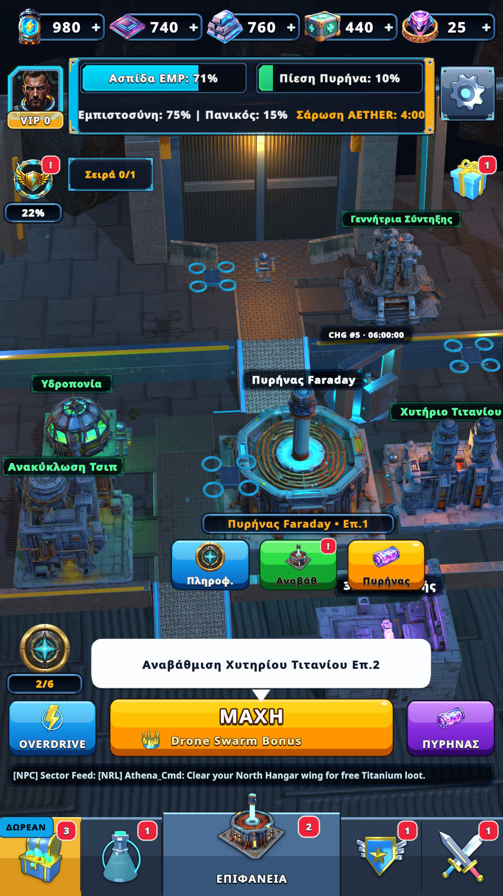
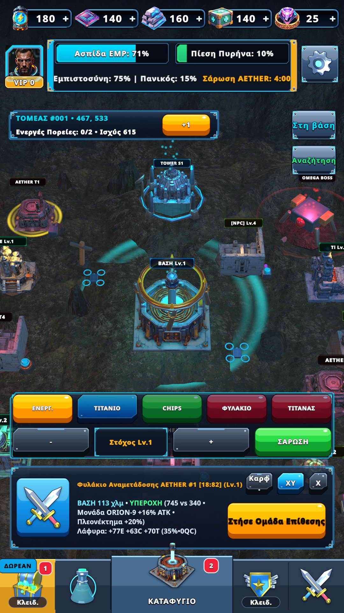
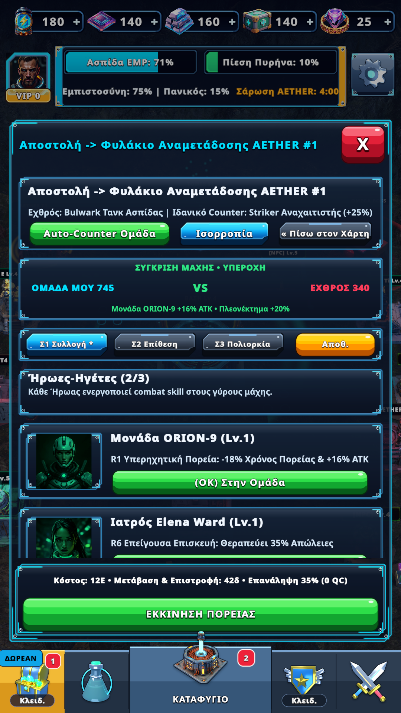
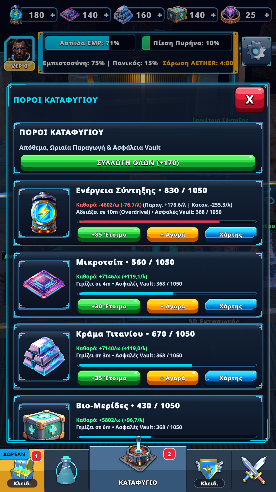
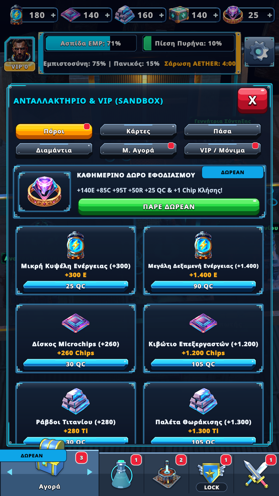

# Neuralis: Zero Hour — Official Pre-Release Builds & Live Preview

Mobile AI Apocalypse Survival Strategy game (**Unity 6 URP 3D**, **Android ARM64 & WebGL**, Greek & English).  
Command a subterranean Faraday bunker, balance EMP shielding and reactor stress, automate articulated repair bots with a 6-hour charging rotation, recruit cybernetic Vanguard heroes, coordinate Syndicate rallies, and battle across a 3D Isometric Sector World Map.

---

## Live Browser Preview (`v1.6.0`)

- **Play Instantly in Browser (WebGL):** https://jemangr.github.io/neuralis-releases/
- Built with Unity 6 **Gzip compression**, **decompression fallback**, **content-hashed `.unityweb` assets**, and `?v=1.6.0` cache busting.

---

## Latest Previews (`v1.6.0` & `v1.5.0`)

  
  
  

  
  
  

---

## Download Latest Published APK

- **Always Latest APK:** [`Neuralis-ZeroHour.apk`](https://github.com/jemangr/neuralis-releases/releases/latest/download/Neuralis-ZeroHour.apk)
- **Latest Published Android Tag:** `v1.6.0` (`VersionCode: 20`, Android ARM64, API 26+, verified on `gh-pages` & APK).

---

## What's New (`v1.6.0`)
- **Unified Combat Matchup & Outpost Rewards:** Map indicator, Dispatch preview, and combat resolution share one deterministic power/modifier formula (`Aria DEF debuff`, tech & counter factors) and unified first-clear vs repeat `35% / 0 QC` outpost rewards.
- **Sticky Dispatch Footer & Named Presets:** Permanent bottom Dispatch bar showing energy cost, round-trip time, next open queue countdown when marches are full (`MAX`), and named squad presets (`Συλλογή`, `Πολιορκία`, `Αναγνώριση` / `Harvest`, `Siege`, `Scout`).
- **3D Bunker Objective Beacon & Quieter Early Badges:** Tapping the Starter Guide banner opens the target facility upgrade directly with resource cost and build time; floating 3D `TARGET` indicator marks the active objective building.
- **Radar Filter Clarity & 100% Greek Map Labels:** Category and `-/+` level controls act as clean filters before scanning (`Αναζήτηση`) with explicit empty-level feedback, plus localized Greek buttons (`Στη βάση`, `Αναζήτηση`, `Κλειδωμένο`).
- **Net Resource Overdrive & Honest Syndicate Help:** Resource overview displays net per-minute change, Overdrive burn, fill/drain ETA, and Hydroponics map routing for Bio-Rations; Alliance Help tracks pending `0/3` member responses until fulfilled.
- **Reliable WebGL Loading (`Gzip + Content Hashes`):** Eliminates stale browser cache mismatches across versions.

### Previous: `v1.5.0` Highlights
- Bunker facility radial action ring, refactored Sector World Map Radar controls, Starter Pack & Supply Store polish, and `233+` passing automated sanity checks.