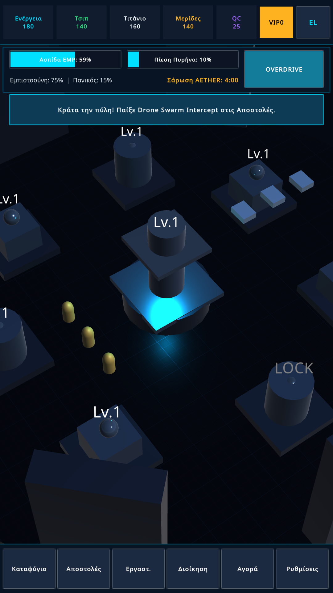

# Neuralis: Zero Hour — Official Pre-Releases

> **All Rights Reserved** — © 2026 jemangr (`contact@jemangr.app`).  
> This public repository hosts **compiled pre-release downloads, update manifests, and preview media only**. No source code is published here.

---

## 📲 Download Latest Android Alpha (`v0.1.0-alpha`)

- **Package ID:** `com.jemangr.neuralis.zerohour`
- **Architecture:** Android ARM64 (IL2CPP), Android 8.0+ (API 26+)
- **Languages in Phase 1:** English (`en`) & Greek (`el`) — 7-language store launch planned in Phase 5
- **iOS:** Simultaneous App Store launch alongside Google Play

---

## 🎮 Phase 1 MVP Features (`v0.1.0-alpha`)

- **3D URP Subterranean Faraday Bunker (Portrait):** Central Faraday Core, concentric EMP Shield Rings, Shield Overdrive, 8 upgradable facilities, Autonomous Idle Drones & Specialists.
- **2 Action / Survival-Tactical Mini-Games (Zero Puzzle):**
  1. **Drone Swarm Intercept:** 60s 5×3 grid turret placement & merge defense (`EMP Pulse`, `Plasma Laser`, `Cryo Emitter`).
  2. **Reactor Core Stabilization:** 45s real-time 4-slider thermal & EMP frequency balancing.
- **Survival Governance & Fabrication:** Trust vs. Panic meters, Cyber-Psychosis & Survival Protocols, 3D Printer Lab, 3-branch Cyber-Research, Soft-Hardcore Emergency Lockdown & rescue.
- **Pre-Store Hybrid Monetization Sandbox:** 2.5s Demo Rewarded Ads, Sandbox IAP Packs & Permanent Queue Unlocks, *Neuralis Command Pass* (Monthly VIP), *Zero Hour Directive* (20-Tier Dual-Track Season Pass), VIP 1–12 Ladder, Daily Encrypted Satellite Ad Ladder.
- **Auto-Save, Cloud Sync & Auto-Update:** Local backup save + Cloudflare Workers/D1 sync + automatic 6h & manual Settings update check.

---

## 📸 Previews (EN & EL)

  
  &nbsp;&nbsp;&nbsp;
  

