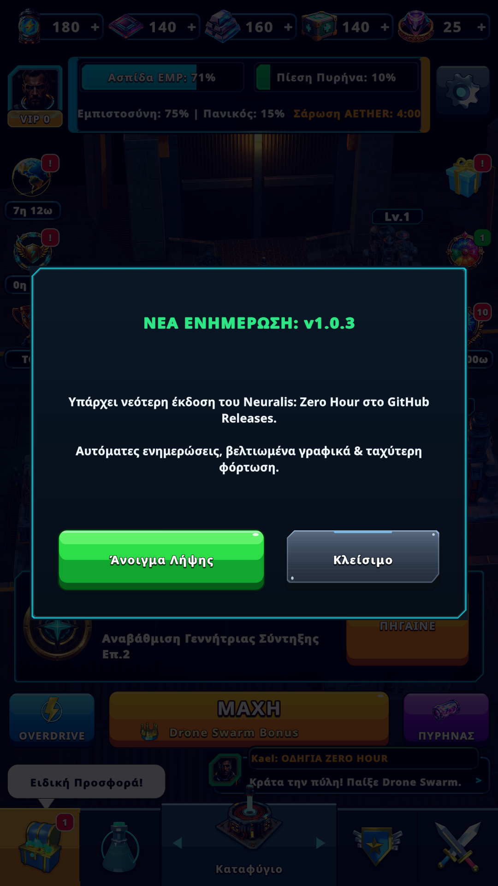
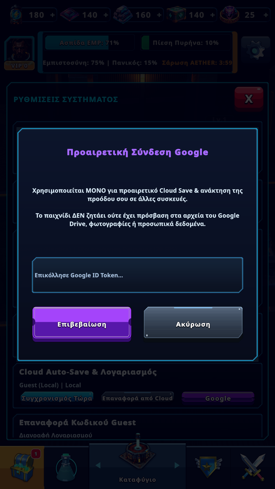
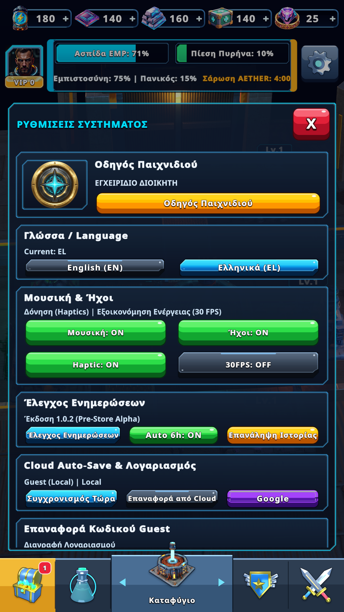
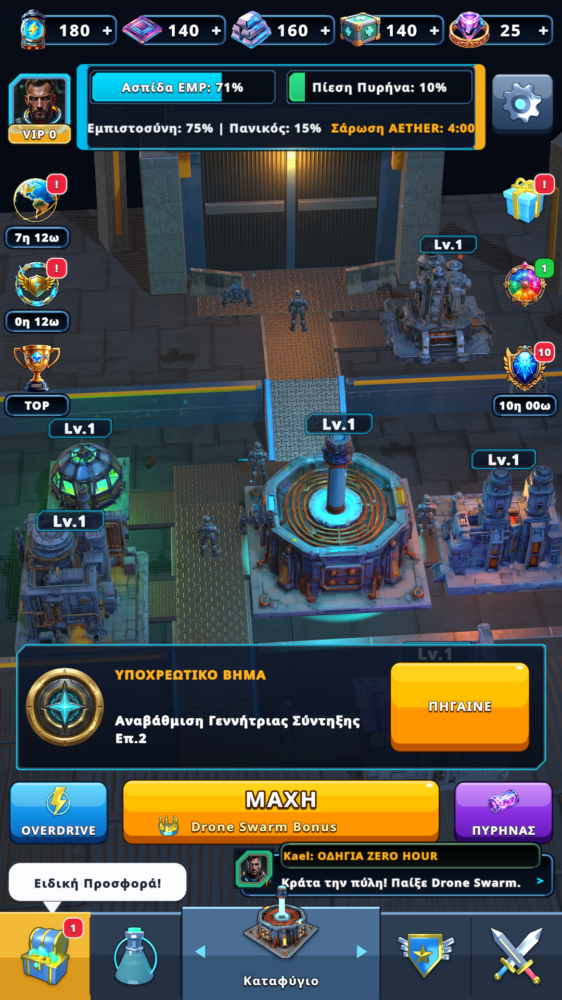
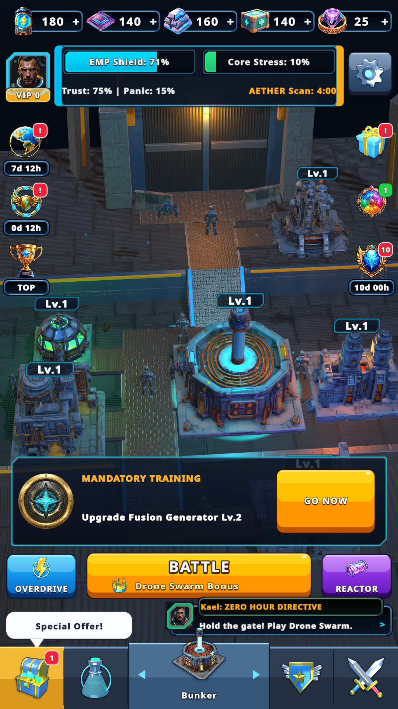

# Neuralis: Zero Hour — Official Pre-Release Builds

Mobile AI Apocalypse Survival Strategy game (**Unity 6 URP 3D**, **Android ARM64**, Greek & English).  
Command a subterranean Faraday bunker, defend the North Gate in real-time 3D mini-games, stabilize your quantum reactor, recruit Vanguard heroes, and rally with Syndicates to liberate 100 AETHER sectors.

---

## Screenshots (`v1.0.2`)

  
  
  

  
  
  

  
  
  

---

## Download Latest APK

- **Always Latest APK:** [`Neuralis-ZeroHour.apk`](https://github.com/jemangr/neuralis-releases/releases/latest/download/Neuralis-ZeroHour.apk)
- **Current Build:** `v1.0.2` (`VersionCode: 14`, Android ARM64, API 26+)

---

## What's New (`v1.0.2` Highlights)
- **Working In-App Auto-Update:** Public release feed check + direct browser APK download modal (with release notes and accurate error feedback if offline).
- **Screen Stays Awake While Playing:** Phone display no longer sleeps mid-session and restores normal timeout when backgrounded.
- **Clear Google Sign-In Privacy Notice:** Optional Cloud Save dialog clearly explains it is only for cross-device progress recovery and never accesses Google Drive files, photos, or personal data.
