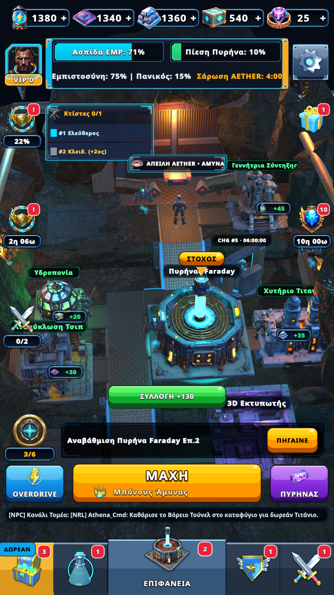
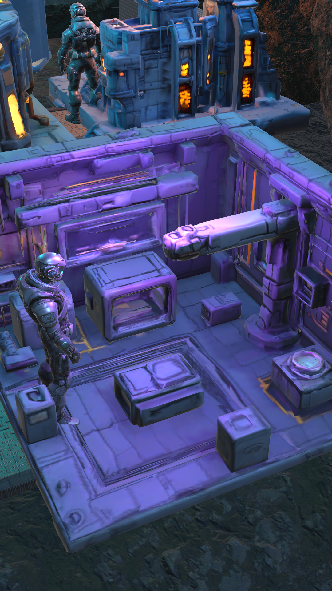
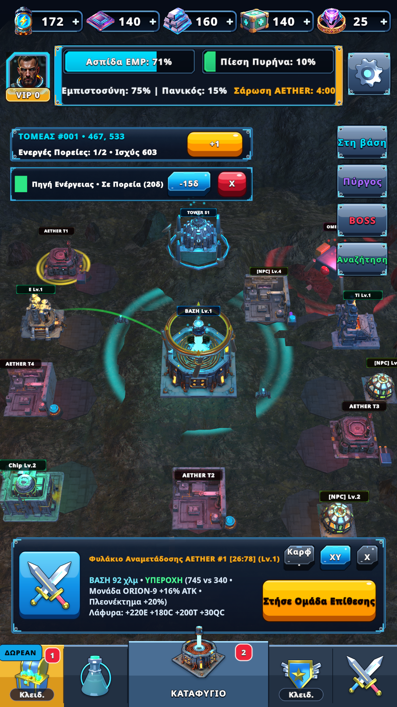
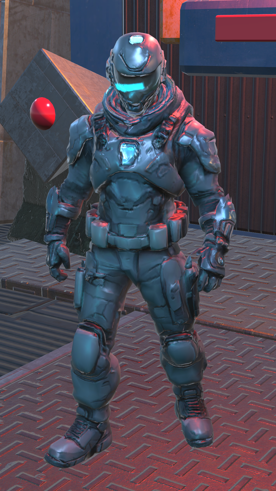

# Neuralis: Zero Hour — Official Pre-Release Builds & Live Preview

Mobile AI Apocalypse Survival Strategy game (**Unity 6 URP 3D**, **Android ARM64 & WebGL**, Greek & English).  
Command a subterranean Faraday bunker, balance EMP shielding and reactor stress, automate articulated repair bots with a 6-hour charging rotation, recruit cybernetic Vanguard heroes, coordinate Syndicate rallies, and battle across a 3D Isometric Sector World Map.

---

## Live Browser Preview (`v2.0.0`)

- **Play Instantly in Browser (WebGL):** https://jemangr.github.io/neuralis-releases/?v=2.0.0
- Built with Unity 6 **Gzip compression**, **decompression fallback**, **content-hashed `.unityweb` assets**, and `?v=2.0.0` cache busting.

---

## Latest Previews (`v2.0.0`)

  
  
  

  
  
  

---

## Download Latest Published APK

- **Always Latest APK:** [`Neuralis-ZeroHour.apk`](https://github.com/jemangr/neuralis-releases/releases/latest/download/Neuralis-ZeroHour.apk)
- **Latest Published Android Tag:** `v2.0.0` (`VersionCode: 24`, Android ARM64, API 26+, verified on `gh-pages` & APK).

---

## What's New (`v2.0.0`)
- **Subterranean Cavern Overhaul (Zero Black Void & Obstruction Removal):** Removed giant diagonal utility pipe slicing across the screen, rock-anchored all stalactites into solid cliff outcrops, and vaulted perimeter rock walls to 48m radius with a 52m bedrock foundation floor eliminating all void clipping.
- **3D Printer Lab Camera Orientation:** Rotated 180° to face South directly toward player camera, exposing glowing laser chamber, robotic arm, and computer terminal.
- **Compact Builder HUD Pill:** Replaced large fixed box with a compact pill (`0/2 ▼`) with wrench icon that expands on tap to display detailed build queues, active countdowns, and facility targets.
- **3D World Map (Sector #001) Multi-Target Visibility:** Widened camera viewport (pitch 48°, distance 68m, FOV 54°) immediately revealing 10+ 3D landmarks (Titanium & Energy nodes, AETHER Outposts, Rival Bunkers, Omega Titan Boss) with a quick-jump navigation dock.
- **Whiteout Survival Free Speedup (<5 min):** Instant free finish for upgrades with under 5 minutes remaining without requiring ad-watching.

### Previous: `v1.9.0` Highlights
- Subterranean Cavern 3D overhaul, Builder Roster HUD card, live overhead upgrade progress bars with countdowns, 3D builder robot dispatch with welding sparks, and full P0/P1/P2 fixes for menu input isolation.
