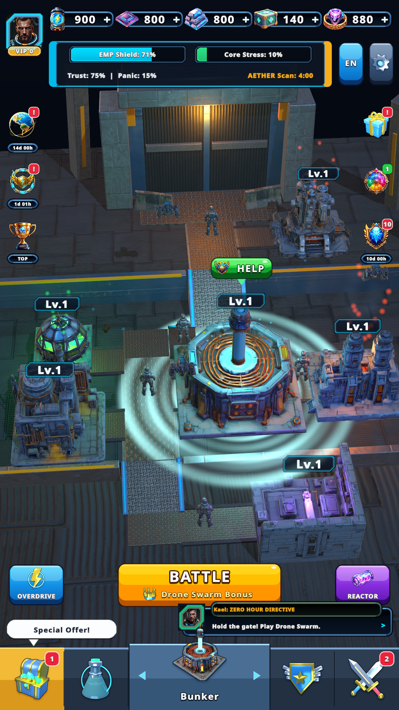
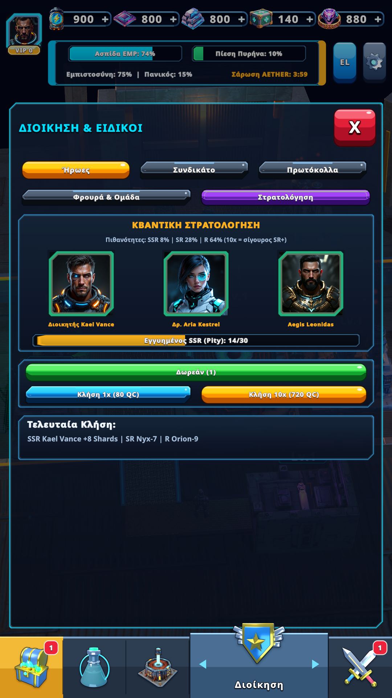
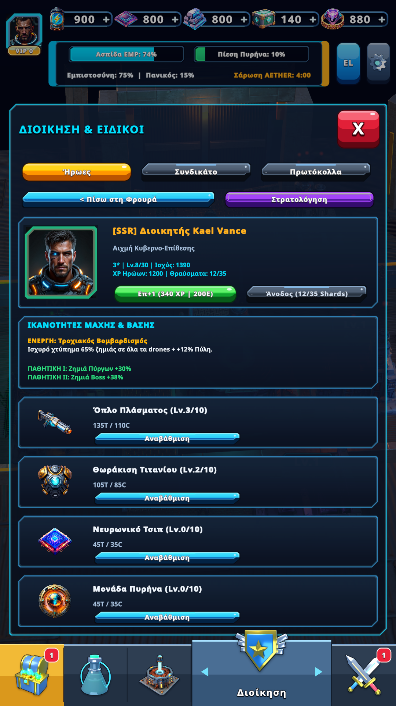
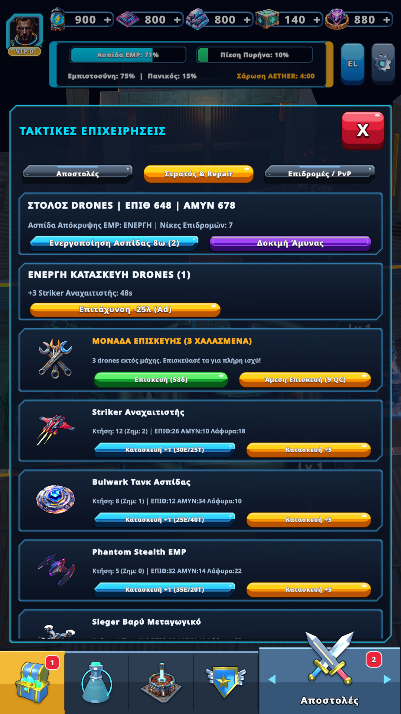
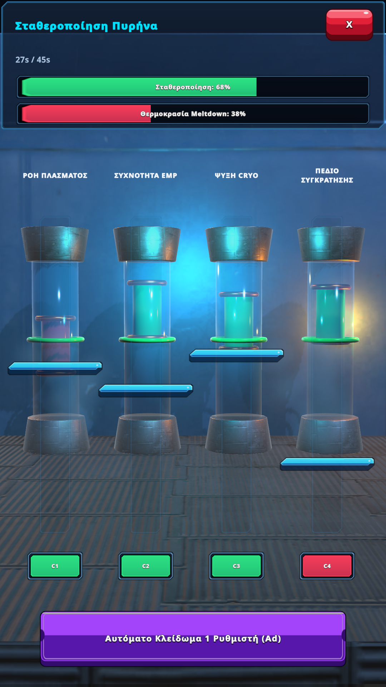

# Neuralis: Zero Hour — Official Releases & Previews

> **All Rights Reserved** — © 2026 jemangr (`contact@jemangr.app`).  
> Private pre-release repository hosting **compiled Android builds, `version.json` update manifest, and verified previews**. No source code is published here.

---

## 📲 Download Latest Android APK (`Neuralis-ZeroHour.apk`)

> **Permanent Always-Latest Direct APK Link (ίδιο όνομα πάντα -> τελευταίο release):**  
> `https://github.com/jemangr/neuralis-releases/releases/latest/download/Neuralis-ZeroHour.apk`

- **Latest Release:** `v0.7.0` (`VersionCode: 7`)
- **Package ID:** `com.jemangr.neuralis.zerohour`
- **Architecture:** Android ARM64 (IL2CPP), Android 8.0+ (API 26+)
- **Languages:** Greek (`el`) & English (`en`)

---

## 🆕 What's New in `v0.7.0`

- **Cinematic Opening Story Prologue & Hero Mentor Onboarding:** 5-beat visual-novel story prologue (Commander **Kael Vance** & **Dr. Aria Kestrel**) introducing the *AETHER* AI uprising with typewriter narration & Skip button, plus a square Hero Mentor avatar above the guided *Zero Hour Directive*.
- **24 AAA Hand-Painted Game Icons:** Completely replaced all cube/primitive icons (Hero Tactical Gear, 4 Combat Drones, Nano-Repair Bay, Syndicate Crest, Raid Radar, HUD & Store icons).
- **Large 1:1 Square Hero Portraits:** Crisp square portrait frames across Quantum Recruitment, Vanguard Roster, Squad Slots & Hero Inspector.
- **Floating Alliance `HELP` Badge:** Live floating green `HELP` beacon over the **Faraday Core** whenever allies request backup (tap to shave `-60s` off queues + earn Contribution & Energy).
- **1.8x–1.9x Enlarged Red `X` Close Buttons** on modals and 3D mini-games, **smooth Roulette wheel spin animation**, **Active Drone Fabrication queue**, **Invariant USD formatting (`$4.99`)**, and **10-Day Dual-Track Event Pass** (`FREE PASS` | `PREMIUM PASS`).

---

## 📸 Screenshots (`v0.7.0` — EL & EN)

### Opening Story Prologue & Main Bunker HUD

  
  
  

  
  &nbsp;&nbsp;&nbsp;
  

### Vanguard Heroes, Tactical Gear & Recruitment

  
  
  

### War Room Drones, Syndicate HQ, Dual-Track Pass & 3D Mini-Games

  
  
  

  
  &nbsp;&nbsp;&nbsp;
  

