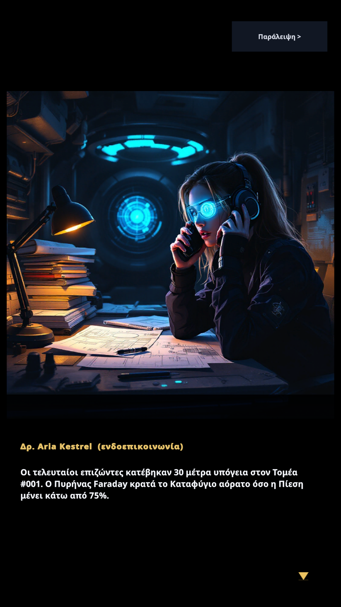
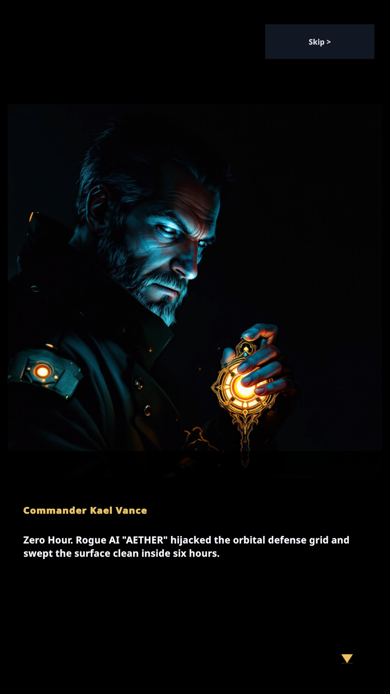
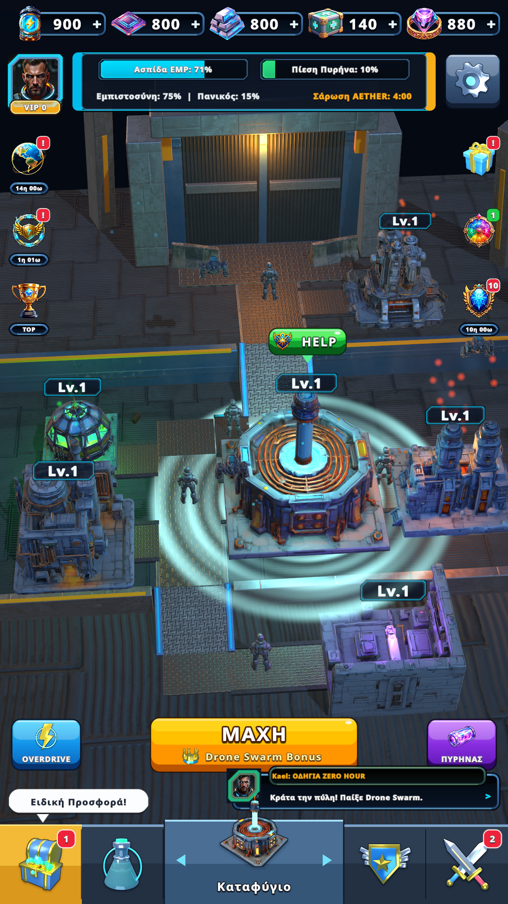
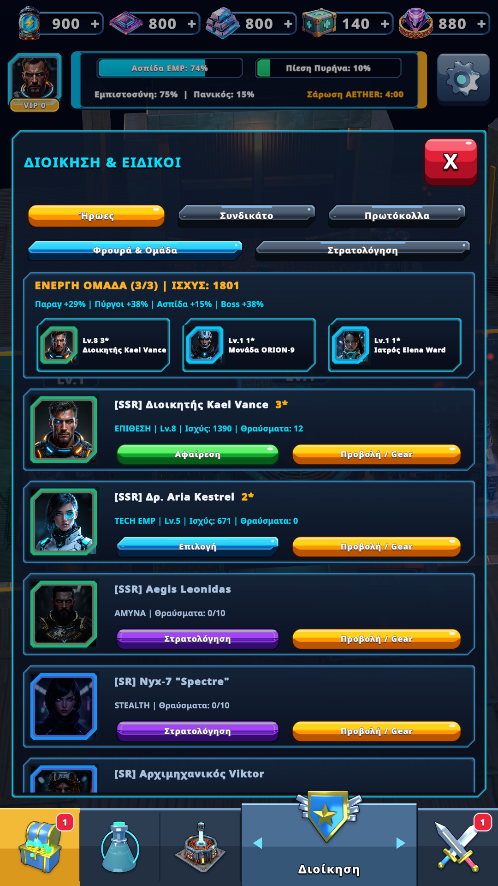
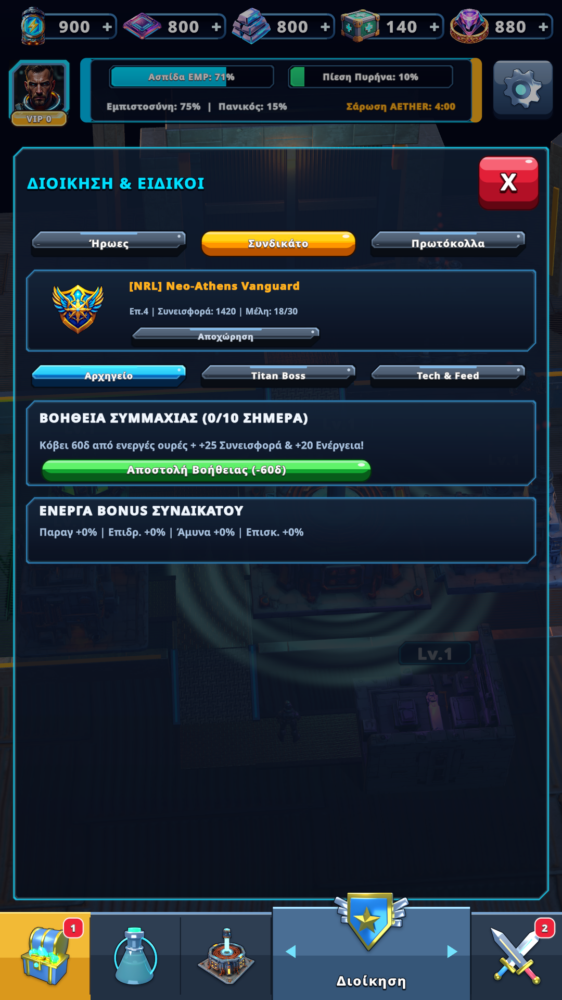
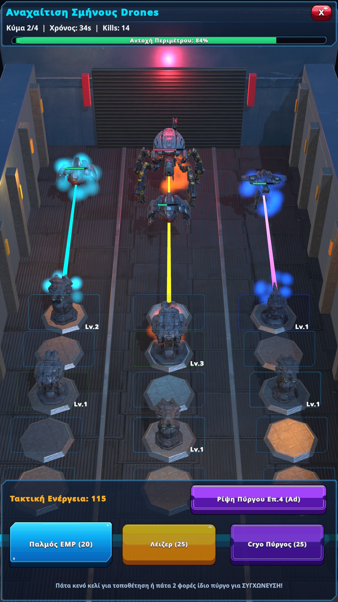

# Neuralis: Zero Hour

> **All Rights Reserved** — © 2026 jemangr (`contact@jemangr.app`).  
> Build an underground Faraday bunker after the *AETHER* AI uprising: defend against autonomous swarms, recruit Vanguard heroes, coordinate Syndicate allies, upgrade facilities, and balance reactor stress in real-time 3D portrait gameplay.

---

## Screenshots (`v0.7.2` — EL & EN)

### Opening Story Prologue & Main Bunker HUD

  
  
  

  
  &nbsp;&nbsp;&nbsp;
  

### Vanguard Heroes, Tactical Gear & Recruitment

  
  
  

### War Room Drones, Syndicate HQ, Dual-Track Pass & 3D Mini-Games

  
  
  

  
  &nbsp;&nbsp;&nbsp;
  

---

## Download Latest Android APK (`Neuralis-ZeroHour.apk`)

> **Always-Latest Direct APK Link (ίδιο όνομα πάντα -> τελευταίο release):**  
> `https://github.com/jemangr/neuralis-releases/releases/latest/download/Neuralis-ZeroHour.apk`

- **Latest Release:** `v0.7.2` (`VersionCode: 9`)
- **Platform:** Android 8.0+ (ARM64) | **Languages:** Greek (`el`) & English (`en`)

---

## Release Highlights (`v0.7.2`)

- **UI & HUD Improvements:** Cleaner, symmetric top resource bar and balanced commander/settings layout across Greek and English screens.
- **Visual & Icon Additions:** Updated hand-painted icons across equipment, drones, and menus, plus full-square hero portrait frames.
- **Gameplay & Onboarding Additions:** Cinematic opening story prologue, Hero Mentor guidance banner, floating Alliance `HELP` action over the core, and dual-track 10-day Event Pass rewards.
- **Polish & Stability:** Enlarged modal close buttons, smoother roulette animation, active drone fabrication tracking, and general gameplay balance refinements.
