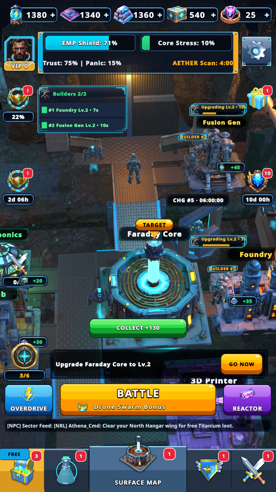
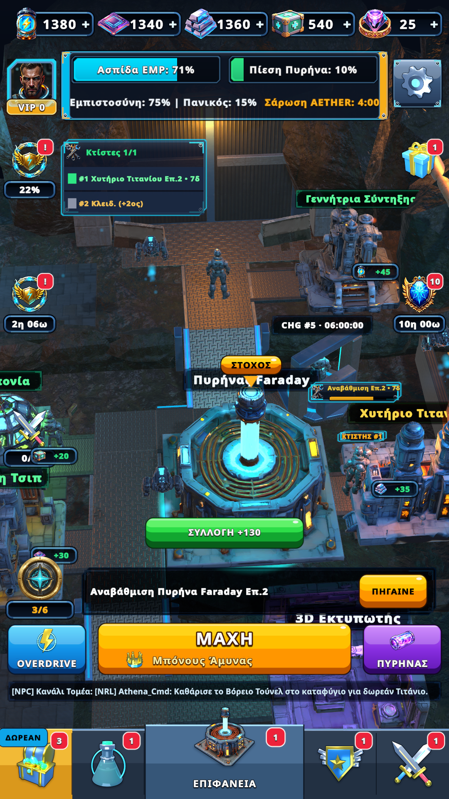

# Neuralis: Zero Hour — Official Pre-Release Builds & Live Preview

Mobile AI Apocalypse Survival Strategy game (**Unity 6 URP 3D**, **Android ARM64 & WebGL**, Greek & English).  
Command a subterranean Faraday bunker, balance EMP shielding and reactor stress, automate articulated repair bots with a 6-hour charging rotation, recruit cybernetic Vanguard heroes, coordinate Syndicate rallies, and battle across a 3D Isometric Sector World Map.

---

## Live Browser Preview (`v1.9.0`)

- **Play Instantly in Browser (WebGL):** https://jemangr.github.io/neuralis-releases/?v=1.9.0
- Built with Unity 6 **Gzip compression**, **decompression fallback**, **content-hashed `.unityweb` assets**, and `?v=1.9.0` cache busting.

---

## Latest Previews (`v1.9.0`)

  
  
  

  
  
  

---

## Download Latest Published APK

- **Always Latest APK:** [`Neuralis-ZeroHour.apk`](https://github.com/jemangr/neuralis-releases/releases/latest/download/Neuralis-ZeroHour.apk)
- **Latest Published Android Tag:** `v1.9.0` (`VersionCode: 23`, Android ARM64, API 26+, verified on `gh-pages` & APK).

---

## What's New (`v1.9.0`)
- **Subterranean Cavern («Σπηλιά») 3D Overhaul:** Replaced flat concrete parking slabs and retaining walls with sculpted basalt bedrock terraces, cliff escarpments, 12 faceted rock outcrops, ceiling stalactites, glowing mineral crystal clusters, and fortified stone tunnel North Blast Gate.
- **Builder Roster HUD & 3D Builder Robot Dispatch:** Top-left `1/1` & `2/2` builder card with live states, floating overhead upgrade progress bars with countdowns, and 3D builder robots navigating on the road network with amber welding sparks and helmet tags.
- **P0 Menu Input Isolation:** Fixed background world clicks and gate threat launches while in modals or overlays.
- **P1 Exact 3-Phase March ETA:** Integrated exact 3-phase march ETA (`2 * travel + action`, 18s gather action, gather subtitle & expected QC harvest copy).
- **P1 Unified Outpost & War Room First-Clear Parity:** Advanced campaign stage on world map clear; War Room raid pays 0 QC and 35% on repeats for already-cleared outposts.
- **P1 UI/UX Polish:** Sub-tab scroll reset on switch, radial quick upgrade inspection card, tower buttons showing spent & gained, and honest speedup labels.

### Previous: `v1.8.0` Highlights
- Sculpted 11-bone skeletal engineers with topological arm skinning, glowing cyan visors, 23-node orthogonal road-graph BFS, Recon Drone thruster trails, and rotated cutaway 3D Printer.