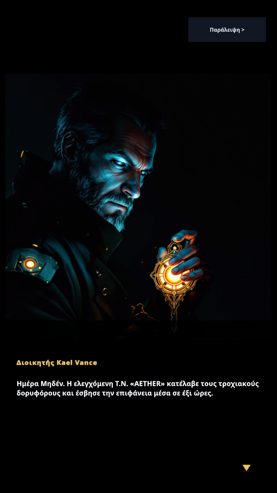
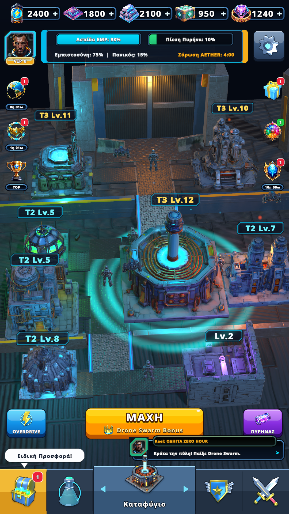
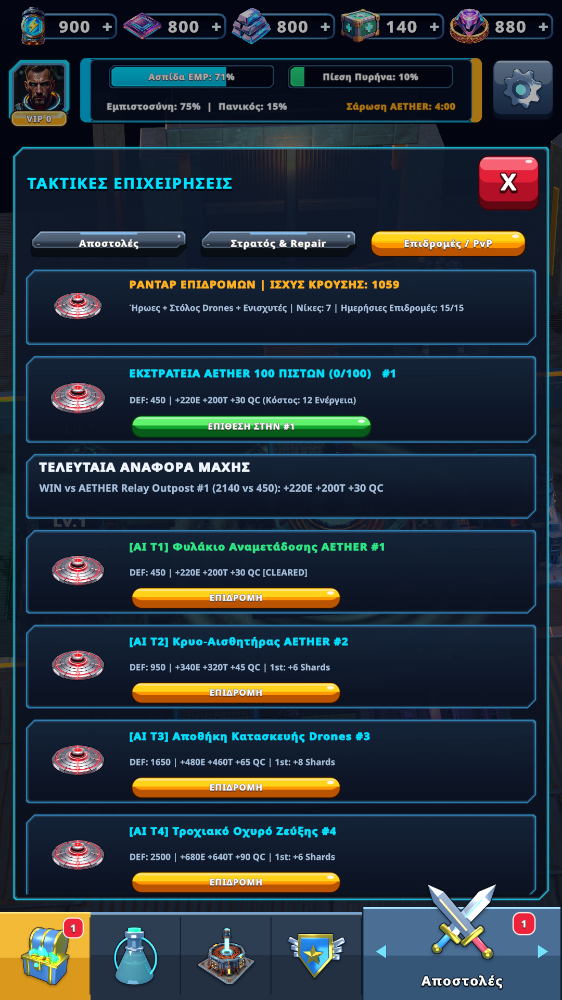
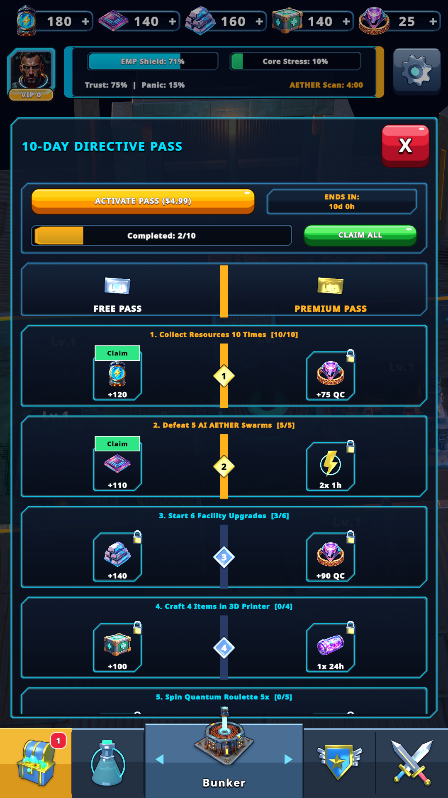
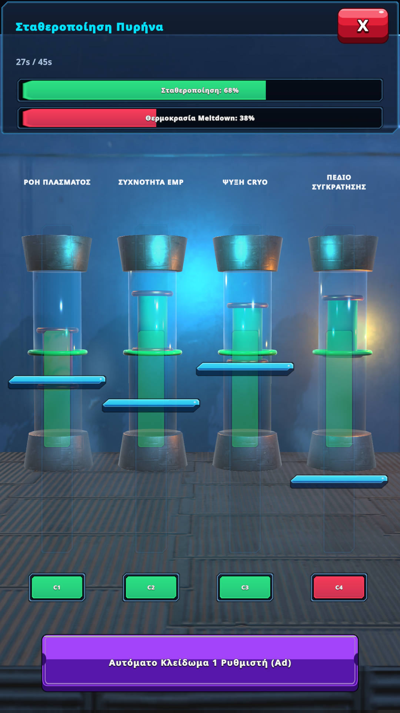

# Neuralis: Zero Hour

> **All Rights Reserved** — © 2026 jemangr (`contact@jemangr.app`).  
> Build an underground Faraday bunker after the *AETHER* AI uprising: defend against autonomous swarms, recruit Vanguard heroes, coordinate Syndicate allies, upgrade tiered facilities, and liberate 100 AETHER campaign sectors in real-time 3D portrait gameplay.

---

## Screenshots (`v0.8.0` — EL & EN)

### Opening Story Prologue, Bunker HUD & Tiered Upgrades

  
  
  

  
  
  

### Vanguard Heroes, War Room & 3D Mini-Games

  
  
  

  
  &nbsp;&nbsp;&nbsp;
  

---

## Download Latest Android APK (`Neuralis-ZeroHour.apk`)

> **Always-Latest Direct APK Link (ίδιο όνομα πάντα -> τελευταίο release):**  
> `https://github.com/jemangr/neuralis-releases/releases/latest/download/Neuralis-ZeroHour.apk`

- **Latest Release:** `v0.8.0` (`VersionCode: 10`)
- **Platform:** Android 8.0+ (ARM64) | **Languages:** Greek (`el`) & English (`en`)

---

## Release Highlights (`v0.8.0`)

- **New Progression & Additions:** Added 100-Stage AETHER Campaign sectors with milestone boss battles, plus tiered visual building upgrades across facility levels.
- **Visual & Mini-Game Improvements:** Restored post-processing lighting/bloom, added clear target green zones in Reactor Core, fixed exit button sizing and laser effects in Drone Swarm, and refined floating Help positioning.
- **Economy, Controls & Security:** Improved storage overflow protection, Android Back button navigation, account recovery/management options in Settings, and general balance, anti-cheat, and stability fixes.
