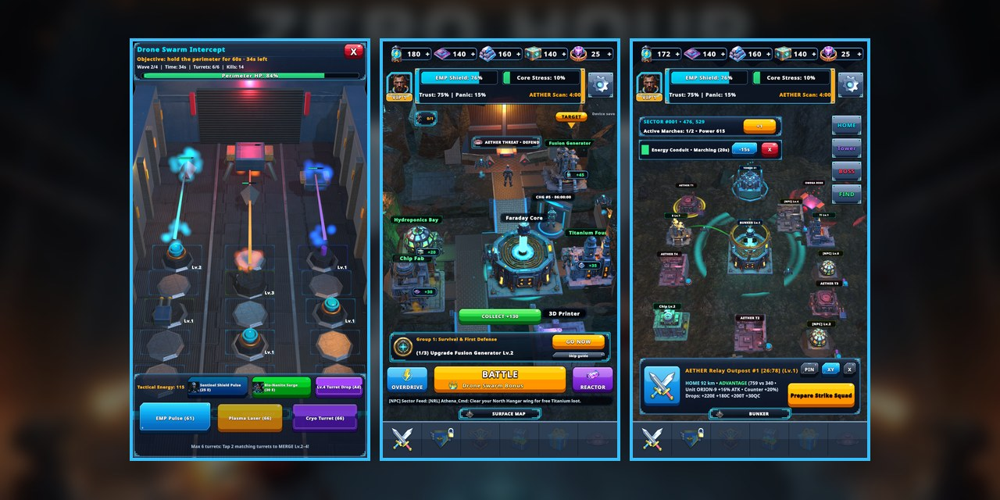
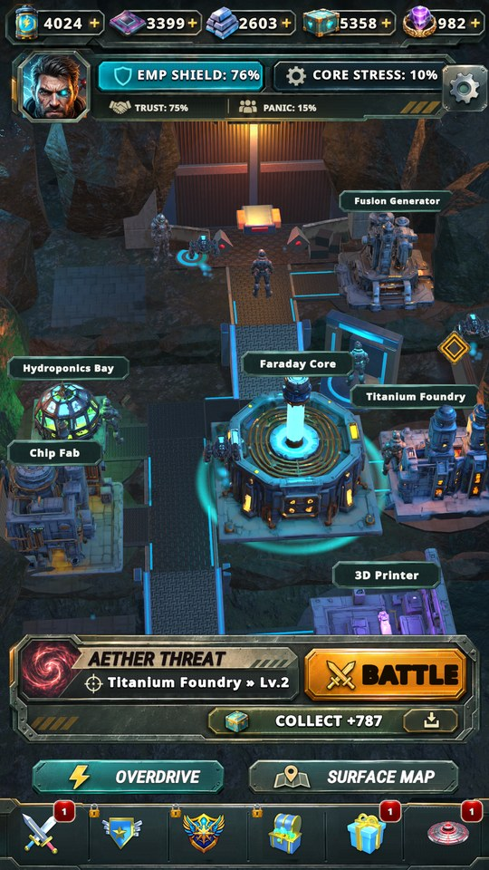
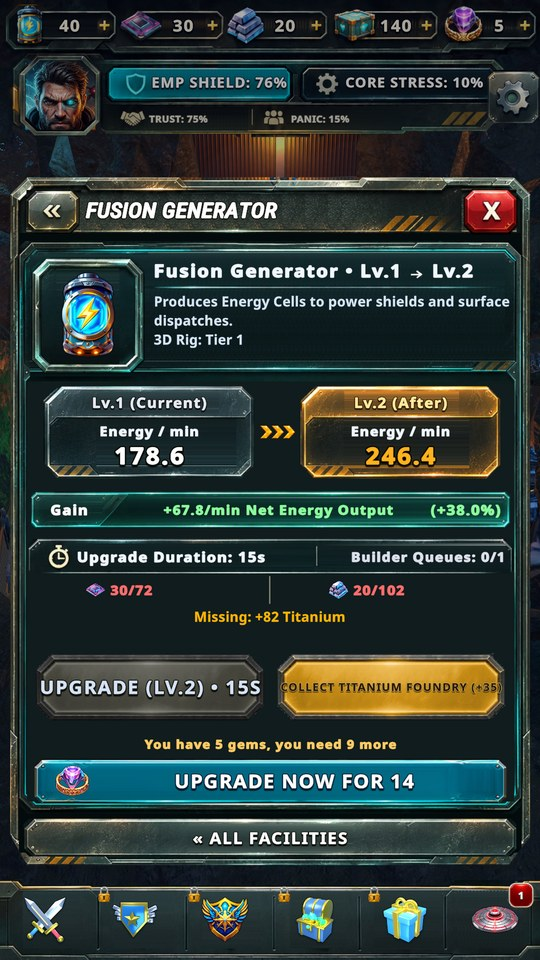
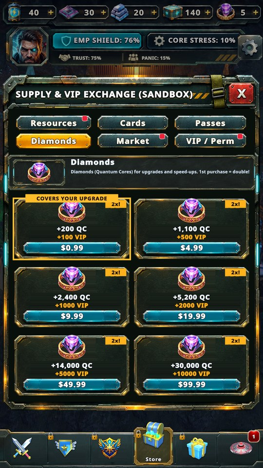
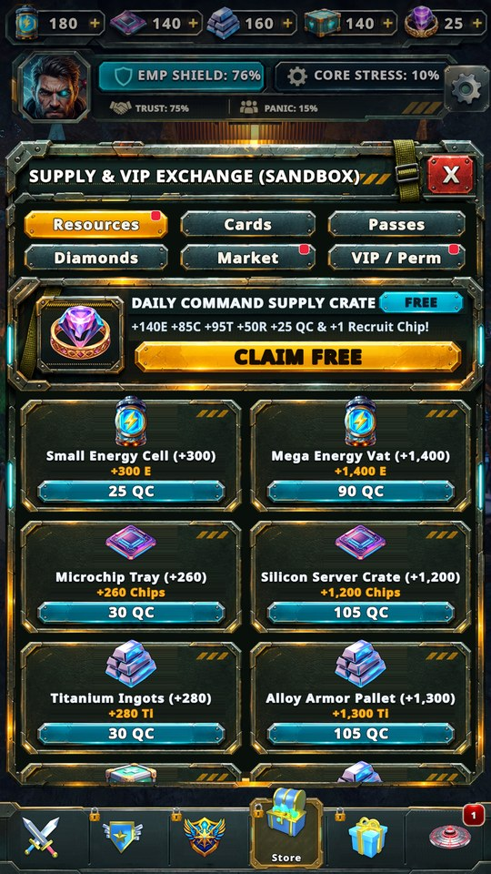
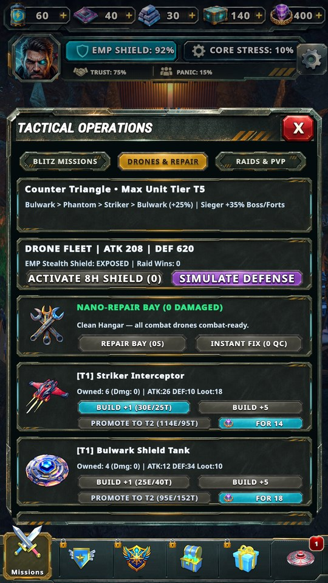
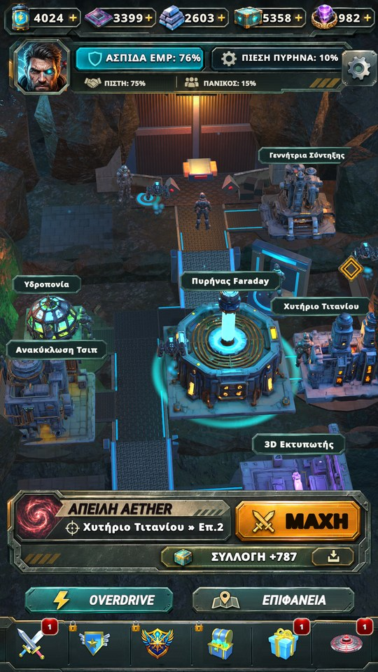
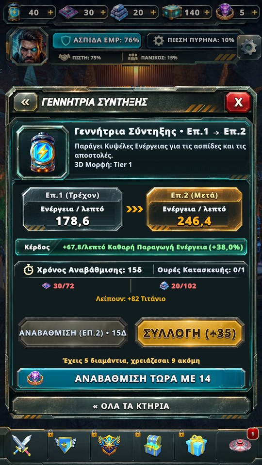
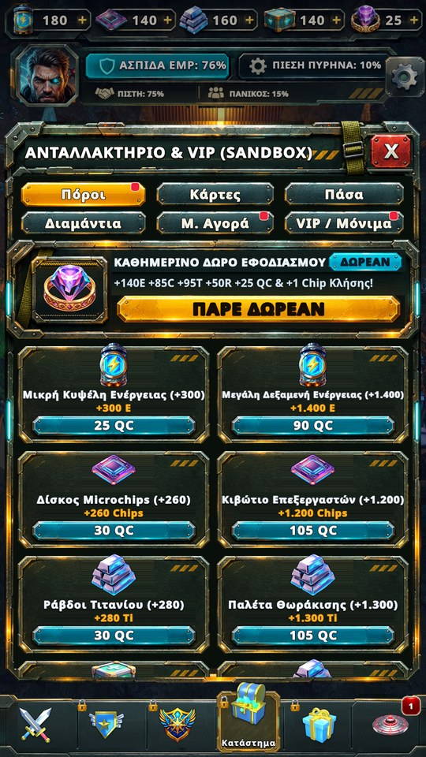

  

<h1 align="center">Neuralis: Zero Hour</h1>

<b>The AI took the surface. You still hold the bunker.</b> 
A free sci-fi survival-strategy game for Android and the browser.

  
  

  
  
  
  

---

Zero Hour. A rogue AI called **AETHER** hijacked the orbital defense grid and swept the surface clean in six hours. The last survivors fled thirty meters underground, into a Faraday bunker that keeps them hidden as long as its shield holds.

You are their commander. Build, research, defend and strike back.

## Features

- **Build your bunker** – grow 8 facilities in a living 3D cavern, from the Faraday Core to the Drone Hangar, and watch your engineers and repair bots at work.
- **Stay hidden** – balance the EMP shield, reactor heat, trust and panic while AETHER scans for you.
- **Defend the gate** – *Drone Swarm Intercept*: place and merge turrets to hold the perimeter for 60 seconds. Your first battle is guided step by step.
- **Lead heroes and drones** – recruit 8 heroes with combat skills and send drone squads (T1–T10) across a 3D surface map: outposts, rival bunkers, resource nodes and a boss.
- **Play together** – join a Syndicate, help allies build faster, rally against bosses and chat.
- **Your progress, everywhere** – automatic cloud save and a recovery code to move to a new phone. No sign-in required.
- **English and Greek** – the game starts in your device's language.

## Screenshots

  
  
  
  

  
  
  
  

## Get the game

| | How |
|---|---|
| **Android** | Tap **Download APK** above, open the file and allow installs from your browser if Android asks. Updates install over the previous version and keep your progress. |
| **Browser** | Tap **Play Online**. The first load downloads the game once (about 100 MB); after that it starts in seconds. |

The download link always points to the newest version:
`https://github.com/jemangr/neuralis-releases/releases/latest/download/Neuralis-ZeroHour.apk`

## System requirements

- **Android:** Android 8.0 or newer, 64-bit (ARM64) device, about 80 MB of free space.
- **Browser:** a current desktop version of Chrome, Edge, Firefox or Safari with WebGL 2. Phones can play in the browser too, but the Android app runs smoother.
- An internet connection is needed for cloud save, chat and multiplayer features; the base game also runs offline.

## Privacy

- You play as a guest. No sign-in, email or real name is required.
- Your progress is saved on your device and, when you're online, to the game server under an anonymous player ID, so you can restore it with your recovery code.
- The game sends basic gameplay events (for example, "battle finished") to help balance it. Chat messages you send are stored so other players can read them and so abuse can be reported.
- You can delete your account and cloud data at any time in **Settings → Delete Account**.
- A full privacy policy will be published at [playneuralis.app](https://playneuralis.app).

## What's new

See the [latest release notes](https://github.com/jemangr/neuralis-releases/releases/latest).

## Links

- Website: [playneuralis.app](https://playneuralis.app)
- All versions: [Releases](https://github.com/jemangr/neuralis-releases/releases)

---

© 2026 Neuralis: Zero Hour. All rights reserved. The game files are provided for personal play only; see <a href="LICENSE">LICENSE</a>.
